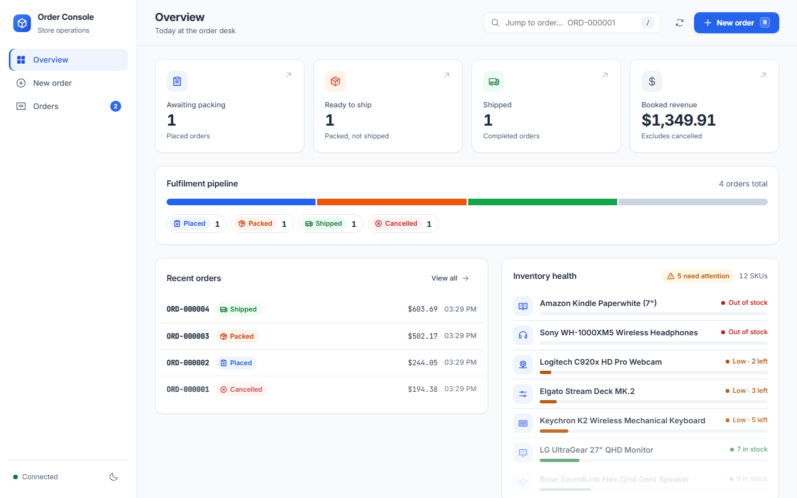
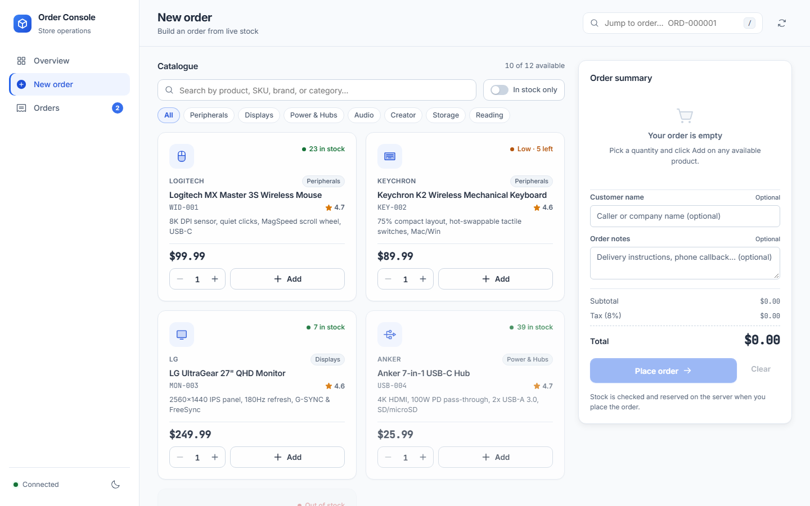
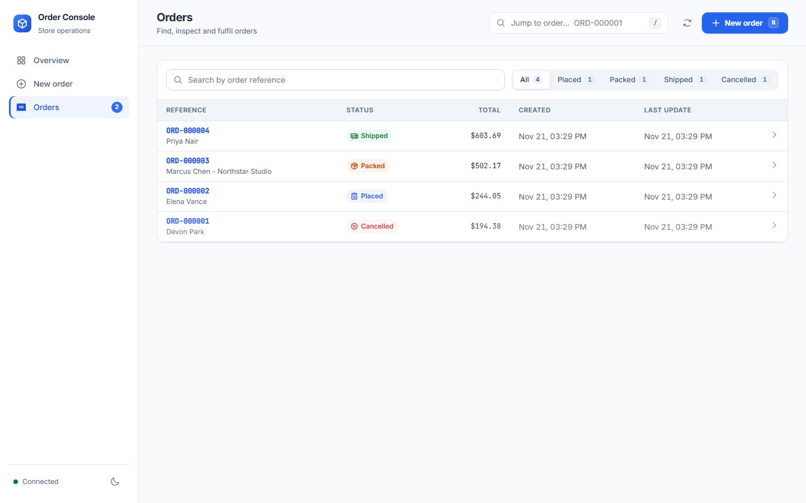
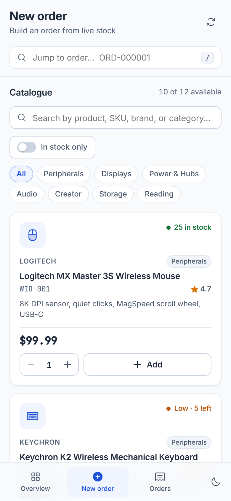

# Commerce Order Console

A full-stack phone-order desk console for creating orders against live inventory, inspecting order details, and driving fulfilment transitions safely. Powered by **Node.js + built-in SQLite (`node:sqlite`)** with **zero backend npm dependencies** and a modern **React + TypeScript + Framer Motion** frontend pre-built into `public/`.

> Looking for a guided tour with API verification commands and screenshots? See [docs/WALKTHROUGH.md](docs/WALKTHROUGH.md).



---

## Requirements

- **Node.js 22.5+** (uses built-in `node:sqlite`; verified on Node.js 24).
- No external database or backend `npm install` required.

---

## Quick Start

```bash
npm run seed      # creates data/orders.db and loads the 12-product catalogue (no-op if already seeded)
npm start         # starts http://localhost:3000 (auto-seeds if empty; override with PORT=4000)
npm run reseed    # wipes orders + catalogue and restores initial 12-product stock
npm test          # runs the 13 automated API, consistency, persistence & migration tests
```

Environment variables:

- `PORT` — HTTP listening port (default: `3000`).
- `DB_FILE` — Path to the SQLite database file (default: `data/orders.db`; supports `:memory:` for ephemeral runs).

### Frontend Development (`client/`)

The compiled frontend bundle is committed to `public/` and served directly by `npm start`. To modify or rebuild the React + TypeScript client:

```bash
cd client
npm install
npm run dev       # Vite dev server on http://localhost:5173 with /api proxied to :3000
npm run build     # runs tsc --noEmit and builds production assets into ../public
```

---

## Seed Catalogue (12 Products)

The seed dataset contains 12 real-world electronics/desk products across 7 categories, including **2 out-of-stock SKUs** (`HDP-005` and `KDL-012`) to test out-of-stock UI gating and atomic rejection rules:

| ID | SKU | Product | Brand | Category | Rating | Price | Initial Stock |
|---:|---|---|---|---|---:|---:|---:|
| 1 | `WID-001` | Logitech MX Master 3S Wireless Mouse | Logitech | Peripherals | 4.7 | $99.99 | 25 |
| 2 | `KEY-002` | Keychron K2 Wireless Mechanical Keyboard | Keychron | Peripherals | 4.6 | $89.99 | 5 |
| 3 | `MON-003` | LG UltraGear 27" QHD Monitor | LG | Displays | 4.6 | $249.99 | 8 |
| 4 | `USB-004` | Anker 7-in-1 USB-C Hub | Anker | Power & Hubs | 4.7 | $25.99 | 40 |
| 5 | `HDP-005` | **Sony WH-1000XM5 Wireless Headphones** | Sony | Audio | 4.6 | $349.99 | **0 (Out of stock)** |
| 6 | `CAM-006` | Logitech C920x HD Pro Webcam | Logitech | Creator | 4.6 | $64.99 | 3 |
| 7 | `SSD-007` | Samsung T7 Shield 1TB Portable SSD | Samsung | Storage | 4.8 | $99.99 | 18 |
| 8 | `EAR-008` | Apple AirPods Pro (2nd Gen) | Apple | Audio | 4.7 | $249.00 | 12 |
| 9 | `SPK-009` | Bose SoundLink Flex (2nd Gen) Speaker | Bose | Audio | 4.8 | $149.00 | 9 |
| 10 | `CRD-010` | Elgato Stream Deck MK.2 | Elgato | Creator | 4.8 | $149.99 | 4 |
| 11 | `PWR-011` | Anker Prime 20,000mAh Power Bank | Anker | Power & Hubs | 4.7 | $109.99 | 15 |
| 12 | `KDL-012` | **Amazon Kindle Paperwhite (7")** | Amazon | Reading | 4.7 | $159.99 | **0 (Out of stock)** |

---

## Features

- **Overview Dashboard (`/#/`)**
  - Clickable KPI cards (**Awaiting packing**, **Ready to ship**, **Shipped**, **Booked revenue** excluding cancelled orders) that drill directly into filtered order lists.
  - Proportional **Fulfilment pipeline** bar with clickable status legend pills.
  - **Recent orders** quick-open list and **Inventory health** monitor sorted by lowest stock first, flagging out-of-stock and low-stock SKUs.
- **New Order Builder (`/#/new`)**
  - Real-time catalogue search across product name, SKU, brand, and category.
  - Interactive category filter chips and an **In stock only** toggle switch.
  - Stock-capped quantity steppers, live "in order" / remaining availability indicators, and disabled states for out-of-stock products.
  - Sticky **Order summary** with optional **Customer name** (up to 120 chars) and **Order notes** (up to 500 chars), live **Subtotal + Tax (8%) = Total** breakdown, and inline server rejection alerts.
- **Orders & Fulfilment Drawer (`/#/orders`)**
  - Debounced search by partial, case-insensitive order reference or customer name, paired with segmented status filter pills showing live counts.
  - Slide-over **Order detail drawer** with one-click reference copy, 3-step visual fulfilment timeline (`Placed → Packed → Shipped`), customer/notes card, itemized SKU breakdown, Subtotal/Tax/Total summary, and `Created` / `Last updated` timestamps.
  - Context-aware actions (`Mark as packed`, `Mark as shipped`, and `Cancel order` with a focus-trapped confirmation modal). Terminal states (`Shipped`, `Cancelled`) are locked.
- **Ergonomics, Sync & Accessibility**
  - Light and dark theme toggle persisted in `localStorage`.
  - Keyboard shortcuts: **`/`** focuses global order jump search, **`N`** opens New order, **`Escape`** dismisses drawers/dialogs or blurs search.
  - Multi-staff **live focus & visibility sync** (automatically refreshes stock and orders when returning to the tab, clamping cart quantities to live stock) plus an on-demand topbar refresh button and offline connection banner.
  - Responsive layout tested down to `390px` mobile screens; honours `prefers-reduced-motion`.

<details>
<summary>View New Order, Orders &amp; Mobile Screenshots</summary>

| New Order (Desktop) | Orders List (Desktop) |
|---|---|
|  |  |

**Mobile Responsive View (`390px` viewport):**



</details>

---

## API Reference

All API responses return JSON with `Cache-Control: no-store`.

| Method | Path | Description | Success | Error Codes |
|---|---|---|---|---|
| `GET` | `/api/health` | Server health with live `{ ok, products, orders }` counts | `200` | `405` |
| `GET` | `/api/products` | Full catalogue sorted by `id` with `sku`, `name`, `brand`, `category`, `description`, `rating`, `priceCents`, `stock` | `200` | `405` |
| `GET` | `/api/orders` | List orders newest-first. Optional query params: `search` (partial, case-insensitive match on `ref` or `customerName`) and `status` (`Placed` \| `Packed` \| `Shipped` \| `Cancelled`) | `200` | `400 INVALID_FILTER`, `405` |
| `POST` | `/api/orders` | Place an order. Body: `{ items: [{ productId, quantity }], customerName?, notes? }` (duplicate product lines are merged; max `1000` combined qty per product) | `201` | `400 VALIDATION` / `BAD_JSON`, `409 INSUFFICIENT_STOCK`, `413 TOO_LARGE` |
| `GET` | `/api/orders/:ref` | Order detail including `items` (with `sku`), `subtotalCents`, `taxCents`, `totalCents`, `customerName`, `notes`, and `allowedTransitions` (case-insensitive ref lookup) | `200` | `400 BAD_URL`, `404 ORDER_NOT_FOUND` |
| `POST` | `/api/orders/:ref/status` | Transition status. Body: `{ status: "Packed" \| "Shipped" \| "Cancelled" }` | `200` | `400 VALIDATION`, `404 ORDER_NOT_FOUND`, `409 INVALID_TRANSITION` |

### Error Envelope

Every error response uses a consistent JSON structure:

```json
{
  "error": {
    "code": "INSUFFICIENT_STOCK",
    "message": "Order rejected: Sony WH-1000XM5 Wireless Headphones is out of stock",
    "details": [
      {
        "productId": 5,
        "name": "Sony WH-1000XM5 Wireless Headphones",
        "requested": 1,
        "available": 0,
        "reason": "OUT_OF_STOCK",
        "message": "Sony WH-1000XM5 Wireless Headphones is out of stock"
      }
    ]
  }
}
```

---

## Consistency & Transactional Guarantees

- **Single-transaction writes (`BEGIN IMMEDIATE`):** Both `createOrder` and `changeStatus` execute inside an immediate SQLite write transaction (`WAL` mode + `busy_timeout = 5000` + `foreign_keys = ON`), preventing partial updates and write races.
- **All-or-nothing stock reservation:** Every line item (after merging duplicate `productId` entries) is checked before anything is written. If any item is missing or short on stock, the entire order is rejected with `409 INSUFFICIENT_STOCK` — zero orders are created and zero stock moves.
- **Database-level non-negative stock guard:** `products.stock` enforces `CHECK (stock >= 0)`, and deductions use `UPDATE products SET stock = stock - ? WHERE id = ? AND stock >= ?`.
- **Enforced state machine & exactly-once cancel restoration:**
  - Allowed transitions: `Placed → Packed | Cancelled`, `Packed → Shipped | Cancelled`; `Shipped` and `Cancelled` are terminal.
  - Status updates use a guarded predicate (`WHERE id = ? AND status = ?`). Cancellation restores item stock in the same transaction as the status change, so repeated or concurrent cancels fail with `409 INVALID_TRANSITION` and stock is restored **exactly once**.
- **Restart persistence & safe migrations:** Orders and live stock persist in `data/orders.db` across restarts (`seed()` never overwrites existing stock). `open()` applies idempotent `ALTER TABLE` migrations when opening legacy databases and backfills `subtotal_cents`.
- **Static asset safety & caching:** Path traversal outside `public/` is blocked (`404`), HTML is served with `Cache-Control: no-cache`, and hashed `/assets/*` bundles (JS, CSS, `.woff2`, `.woff`) are served with proper MIME types and `public, max-age=31536000, immutable`.

---

## Automated Tests (`npm test`)

`npm test` runs **13 tests** in `test/api.test.js` using Node's built-in test runner (`node --test`):

1. `GET /api/health` live product and order counts.
2. Enriched 12-item `GET /api/products` schema (`brand`, `category`, `description`, `rating`, stock).
3. Order placement stock deduction, `subtotalCents` / `taxCents` (8%) / `totalCents`, and item SKUs.
4. Optional `customerName` and `notes` trimming, persistence, boundary lengths (`120` / `500`), and invalid input rejection.
5. **Acceptance 1:** Insufficient/out-of-stock line rejects the entire order atomically; valid item stock stays unchanged and 0 orders are created.
6. Duplicate product line merging and atomic rejection when combined quantity exceeds stock or exceeds `1000`.
7. **Acceptance 2:** Cancel from `Placed` restores stock once; repeat cancel fails with `409` and stock stays unchanged.
8. Cancel from `Packed` restores stock once; repeat cancel fails with `409`.
9. Full invalid state transition matrix (skipping, backwards, post-ship, post-cancel) and case-insensitive reference lookup.
10. Malformed JSON, non-object JSON bodies, bad URL encoding, invalid quantities/product IDs, unknown routes (`404`), unsupported methods (`405` with `Allow`), static cache headers, and path traversal protection.
11. Partial case-insensitive search (by `ref` and `customerName`), status filtering, combined filters, and invalid filter rejection.
12. Full database restart persistence (placed & cancelled orders, live stock, totals, customer name, notes) with `seed()` idempotency.
13. Legacy SQLite schema migration and `subtotal_cents` backfill.

---

## Project Layout

```text
commerce-order-console/
├── src/
│   ├── db.js                 # SQLite schema, idempotent migrations, and 12-product seed
│   ├── service.js            # Transactional order placement, 8% tax, and fulfilment state machine
│   └── server.js             # Zero-dependency HTTP router, static file server, and MIME/cache headers
├── scripts/
│   └── seed.js               # CLI seed / --reset helper
├── test/
│   └── api.test.js           # 13 automated integration & persistence tests
├── client/                   # React 18 + TypeScript + Framer Motion source (Vite)
├── public/                   # Built frontend assets served directly by src/server.js
├── design-system/            # UI design tokens and page specifications
├── docs/
│   ├── WALKTHROUGH.md        # Step-by-step operator & API walkthrough
│   └── screenshots/          # Real headless-browser captures (desktop + mobile)
└── data/
    └── orders.db             # Local SQLite database (auto-created on seed/start)
```
