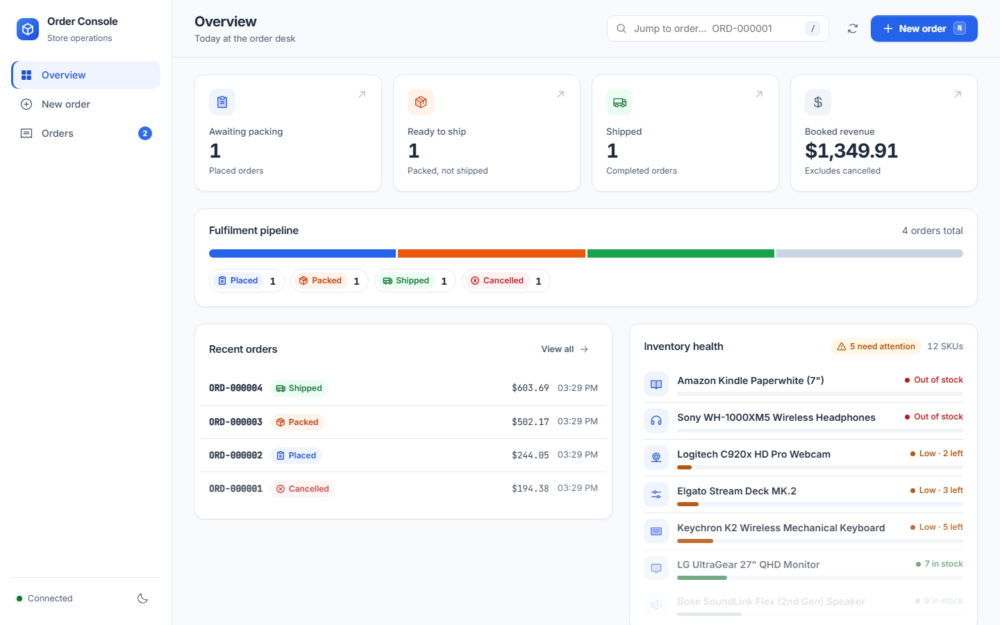
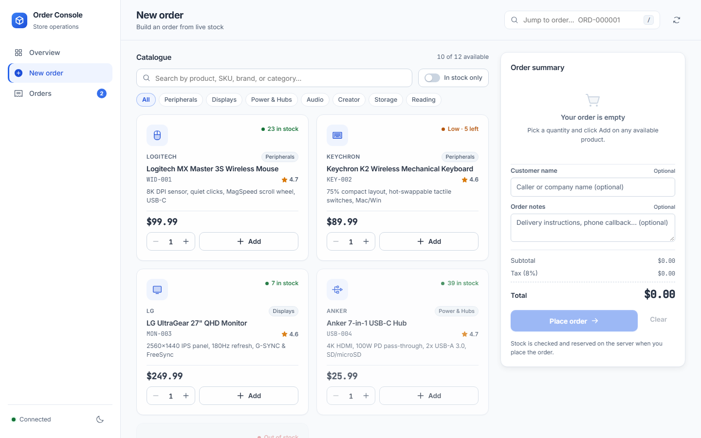
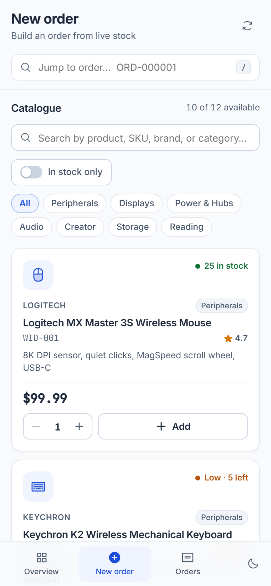
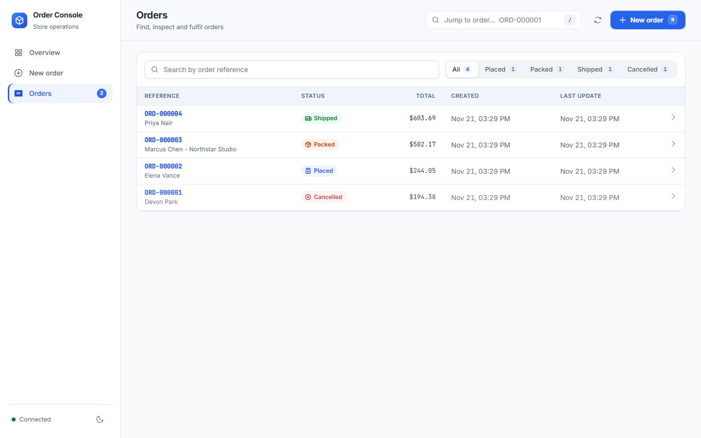

# Commerce Order Console — End-to-End Walkthrough

This walkthrough demonstrates the full phone-order desk workflow: inspecting live operations, searching and filtering the 12-product Amazon catalogue, placing orders with live stock checks and 8% tax calculation, advancing orders through fulfilment, verifying transactional consistency via the API, and confirming persistence across server restarts.

---

## Prerequisites

1. Ensure **Node.js 22.5+** is installed (`node -v`).
2. Start the server from the project root:

```bash
npm start
```

The server automatically seeds `data/orders.db` with the 12-product catalogue if empty and listens on `http://localhost:3000` (override with `PORT=4000` or point to another SQLite file with `DB_FILE=...`).

---

## 1. Inspecting the Overview Dashboard (`/#/`)

Open `http://localhost:3000`. The **Overview** screen summarizes live store operations:

- **KPI Cards:** **Awaiting packing** (`Placed`), **Ready to ship** (`Packed`), **Shipped**, and **Booked revenue** (sum of all non-cancelled order totals, including tax). Clicking any KPI card drills directly into the **Orders** view filtered to that status.
- **Fulfilment pipeline:** Proportional status bar across `Placed`, `Packed`, `Shipped`, and `Cancelled`, paired with clickable legend pills that filter the Orders table.
- **Recent orders:** Click any row to open its full slide-over detail drawer immediately.
- **Inventory health:** All 12 SKUs sorted from lowest to highest stock so out-of-stock items (**Sony WH-1000XM5 Wireless Headphones** and **Amazon Kindle Paperwhite (7")**) and low-stock items (**Logitech C920x HD Pro Webcam**, **Elgato Stream Deck MK.2**, **Keychron K2 Wireless Mechanical Keyboard**) surface at the top.



---

## 2. Filtering & Searching the 12-Product Catalogue (`/#/new`)

Click **New order** in the sidebar (or press **`N`** anywhere outside an input) to open the catalogue builder.

1. **Real-time search:** Type a product name (`Logitech`, `Kindle`), SKU (`KEY-002`), brand (`Anker`, `Apple`), or category (`Audio`) in the catalogue search box to narrow the grid instantly.
2. **Category chips:** Click any category pill — **Peripherals**, **Displays**, **Power & Hubs**, **Audio**, **Creator**, **Storage**, or **Reading** — to isolate that segment (click again or choose **All** to reset).
3. **In stock only toggle:** Flip **In stock only** to hide the 2 out-of-stock products (`HDP-005` Sony WH-1000XM5 Wireless Headphones and `KDL-012` Amazon Kindle Paperwhite (7")). When visible, out-of-stock cards clearly display *Unavailable: out of stock* and cannot be added.
4. **Stock-capped steppers:** Each available product shows its brand, category, SKU, customer rating, description, unit price, and live stock pill. Its quantity stepper automatically caps at remaining stock so staff cannot queue more units than are available.



The layout adapts cleanly down to mobile screens (`390px` viewport width) with a bottom tab bar, full-width catalogue controls, and zero horizontal overflow:



---

## 3. Creating a Phone Order

1. On **New order**, pick quantities and click **+ Add** on multiple in-stock items — for example:
   - **2 × Logitech MX Master 3S Wireless Mouse** (`WID-001`, `$99.99` each)
   - **1 × Anker 7-in-1 USB-C Hub** (`USB-004`, `$25.99`)
2. Review the sticky **Order summary** panel on the right:
   - Each line has an inline stock-capped stepper and remove button.
   - Enter an optional **Customer name** (up to 120 characters, e.g., `Elena Vance`) and **Order notes** (up to 500 characters, e.g., `Call 555-0142 before courier dispatch; suite 4B`).
   - Verify the live breakdown: **Subtotal** (`$225.97`), **Tax (8%)** (`$18.08`), and **Total** (`$244.05`).
3. Click **Place order →**.
   - The server validates and deducts stock in a single SQLite `BEGIN IMMEDIATE` transaction.
   - A confirmation toast appears (`Order ORD-000001 placed`), stock immediately updates (`WID-001`: `25 → 23`, `USB-004`: `40 → 39`), and the console navigates to **Orders** with the new order's detail drawer open.

---

## 4. Finding Orders & Managing Fulfilment (`/#/orders`)

Open **Orders** from the sidebar (the badge shows open `Placed + Packed` orders).

- **Search:** Type a full or partial reference (`ORD-000002`, `000002`, case-insensitive) or customer name (`Elena`, `Northstar`). You can also press **`/`** from any view to focus the topbar jump search and hit Enter.
- **Filter by status:** Switch between **All**, **Placed**, **Packed**, **Shipped**, and **Cancelled** using the segmented filter bar with live counts.



### Inside the Slide-Over Order Drawer

Click any order row to open the **Order Detail Drawer**:

1. **Header & Reference Copy:** Click the copy icon beside `ORD-00000X` to copy the order reference to your clipboard.
2. **Fulfilment Timeline:** Tracks progress visually across **Placed → Packed → Shipped** (or shows a cancelled banner confirming stock restoration).
3. **Customer & Notes:** Displays trimmed caller/company name and delivery or callback notes when present.
4. **Line Items & Totals:** Lists each product with SKU, quantity × unit price, line subtotal, order **Subtotal**, **Tax (8%)**, **Total**, and `Created` / `Last updated` timestamps.
5. **Valid Actions Only:**
   - From **Placed**: click **Mark as packed** (moves to `Packed`) or **Cancel order** (opens confirmation modal, restores stock once, moves to `Cancelled`).
   - From **Packed**: click **Mark as shipped** (moves to `Shipped`) or **Cancel order** (restores stock once, moves to `Cancelled`).
   - From **Shipped** or **Cancelled**: terminal state — no further mutations are permitted (`This order is shipped/cancelled and can't be changed.`).

---

## 5. Verifying Transactional Consistency via the API

Even when bypassing the UI and hitting the HTTP API directly, the server enforces every invariant atomically.

### Acceptance 1 — Whole-Order Rejection on Insufficient Stock

Attempt to order **2 × Keychron K2** (`id=2`, stock `5`) alongside **1 × Sony WH-1000XM5** (`id=5`, stock `0`):

```bash
curl -i -X POST http://localhost:3000/api/orders \
  -H "Content-Type: application/json" \
  -d '{"items":[{"productId":2,"quantity":2},{"productId":5,"quantity":1}]}'
```

- **Expected:** `409 Conflict` with `error.code = "INSUFFICIENT_STOCK"` and `details[0].reason = "OUT_OF_STOCK"`.
- **Verified state:** Keychron K2 stock remains `5`, and no order is created (`GET /api/orders` is unchanged).

### Acceptance 2 — Exactly-Once Stock Restoration on Cancel

1. Place an order for **2 × Keychron K2** (`id=2`, stock `5 → 3`):

```bash
curl -s -X POST http://localhost:3000/api/orders \
  -H "Content-Type: application/json" \
  -d '{"customerName":"Devon Park","items":[{"productId":2,"quantity":2}]}'
```

2. Cancel the order (replace `ORD-000001` with the returned reference):

```bash
curl -i -X POST http://localhost:3000/api/orders/ORD-000001/status \
  -H "Content-Type: application/json" \
  -d '{"status":"Cancelled"}'
```

- **Expected:** `200 OK`, status becomes `Cancelled`, and Keychron K2 stock returns to `5`.

3. Repeat the exact same cancel request:

```bash
curl -i -X POST http://localhost:3000/api/orders/ORD-000001/status \
  -H "Content-Type: application/json" \
  -d '{"status":"Cancelled"}'
```

- **Expected:** `409 Conflict` with `error.code = "INVALID_TRANSITION"`, and Keychron K2 stock stays `5` (never double-restored).

### Invalid Fulfilment Transitions

- Skipping straight from `Placed` to `Shipped` returns `409 Conflict` (`INVALID_TRANSITION`).
- Cancelling a `Shipped` order returns `409 Conflict` (`INVALID_TRANSITION`).
- Moving backwards (e.g., `Packed → Placed`) returns `409 Conflict` (`INVALID_TRANSITION`).

---

## 6. Verifying Persistence Across Restarts

1. Place one or more orders and note their references and updated product stock levels.
2. Stop the Node server (`Ctrl+C`) and restart it with `npm start`.
3. Refresh `http://localhost:3000` (or query `GET /api/health`, `GET /api/products`, and `GET /api/orders`).
   - All orders, statuses, `customerName`, `notes`, subtotal/tax/total values, and deducted/restored stock levels remain intact in `data/orders.db`.
   - Automatic startup seeding is a no-op whenever products already exist.
4. To wipe all orders and restore initial catalogue stock at any time:

```bash
npm run reseed
```

---

## 7. Keyboard Shortcuts, Theme & Multi-Staff Sync

- **`/`** — Focus the topbar order jump search from anywhere (press `Escape` to blur).
- **`N`** — Open the **New order** view immediately.
- **`Escape`** — Close the active order detail drawer or cancel confirmation dialog.
- **Live sync:** Switching back to the browser tab or window automatically refreshes stock and orders (throttled to 1.5s), and the topbar refresh button triggers an on-demand sync while keeping cart quantities clamped to live stock.
- **Light / dark theme:** Toggle via the sun/moon button in the sidebar footer (persisted in `localStorage`).
